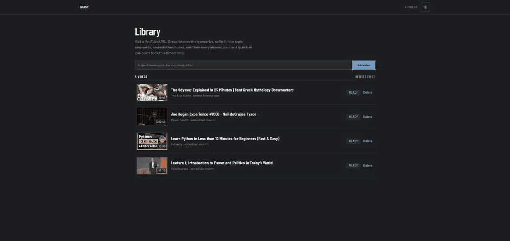
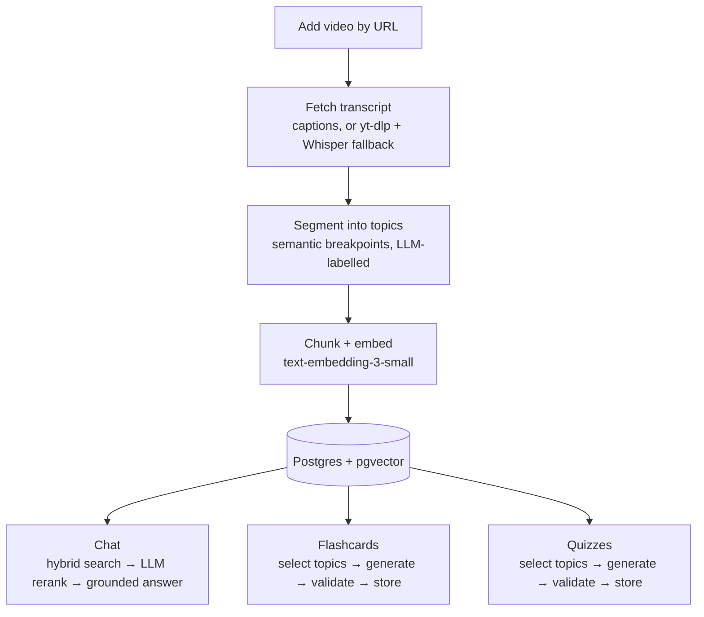

# Grasp

A study companion built on a RAG pipeline over YouTube transcripts. Add a video to your library, then:

- **Chat** with it: answers grounded in the transcript, with clickable timestamps to the moments they come from.
- **Generate flashcard decks**, choosing the count, topics, style and difficulty, and review them.
- **Generate quizzes** with multiple-choice, multi-select and true/false questions, take them, and keep an attempt history.

Every answer, card and question traces back to a moment in the video, and "this video doesn't cover that" is a real answer. The point of the project is **retrieval and generation quality**, and it is measured rather than asserted: hybrid search with an LLM rerank finds the answer's passage first in 93–96% of golden questions, chat answers score 1.00 supported by their sources, and shipped quiz answer keys 0.97–1.00 correct, each over two runs. See [`docs/EVALUATION.md`](docs/EVALUATION.md).



## Architecture



Ingestion runs once per video as a background task. Chat, flashcards and quizzes are three separate tabs hitting three separate endpoint groups. Chat answers a whole-video question from the topic summaries, and anything narrower from the reranked transcript excerpts it retrieves. Flashcards and quizzes share one pipeline: pick topics, build context from their summaries and excerpts, generate with a strict JSON schema, validate every item against its topic's full transcript, and store it. Full detail is in [`docs/ARCHITECTURE.md`](docs/ARCHITECTURE.md).

## Tech stack

| Layer | Choice |
|---|---|
| Backend | FastAPI (Python 3.11+), SQLAlchemy 2, Alembic, Pydantic v2 |
| Frontend | React + TypeScript + Vite, TanStack Query |
| Database | PostgreSQL 16 with `pgvector`: vectors and relational filters in one query, no separate vector DB |
| LLM | OpenAI: `gpt-4o-mini` for generation, `text-embedding-3-small` for embeddings, `gpt-4o` as the eval judge |
| Transcripts | `youtube-transcript-api`, with `yt-dlp` + Whisper as the fallback |
| Local dev | Docker Compose (`api`, `db`, `web`) |

## Setup

Requires Docker and an OpenAI API key.

```bash
cp .env.example .env              # then set OPENAI_API_KEY in .env
docker compose up --build
docker compose exec api alembic upgrade head
```

The web app runs at http://localhost:5173 and the API at http://localhost:8000/api.

Tests: `docker compose exec api pytest` for the backend and `docker compose exec web npm test` for the frontend. The web container keeps `node_modules` in its own volume, so after the web dependencies or Node version change, rebuild with `docker compose up --build -V`.

## Known limitations

- **Chat can call a near-miss answer grounded.** Asked about something the video never mentions but attached to a topic it covers (Gorbachev's reforms, in a lecture that never names him), it is sometimes answered with sources instead of tagged "Not covered" ([#41](https://github.com/jdavidIP/grasp/issues/41)).
- **The question router misses some phrasings.** "What Python concepts does this teach?" is answered from 5 excerpts instead of the whole video, and a follow-up like "tell me more" is routed on its own words, without the conversation.
- **Segmentation is checked by hand, not scored.** Some topic boundaries still land on filler, and whole-video generation gives every topic the same 2 excerpts, so a long topic is thinly represented.
- **Speaker slips are handled, not perfectly.** Generation won't state a misspoken fact as true, but under whole-video scope it sometimes corrects one without writing the note that names it, and a false true/false statement can still exaggerate a speaker's view.
- **The eval set is small, and its judge is an LLM.** Three videos, 28 span-pinned questions and about 30 judged items per group give directional numbers, not precise ones.
- **Single local user, by design.** No accounts, spaced repetition, custom player, deployment setup, sharing or second datastore (see [`CLAUDE.md`](CLAUDE.md)'s scope guardrails).

Each is measured and discussed in [`docs/EVALUATION.md`](docs/EVALUATION.md#known-limitations).

## Docs

- [`docs/ARCHITECTURE.md`](docs/ARCHITECTURE.md): ingestion, segmentation, retrieval, generation, evaluation methodology, and design decisions.
- [`docs/EVALUATION.md`](docs/EVALUATION.md): eval results, what each change taught, and the limitations in detail.
- [`docs/DATA_MODEL.md`](docs/DATA_MODEL.md): schema and pgvector setup.
- [`docs/API.md`](docs/API.md): endpoint contracts.

## License

[MIT](LICENSE)
